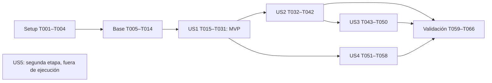

# Tasks: CV Studio — Adaptación de CV y seguimiento laboral

**Input**: `specs/002-cv-job-studio/` — [spec.md](spec.md), [plan.md](plan.md), [research.md](research.md), [data-model.md](data-model.md), [contracts/](contracts/), [quickstart.md](quickstart.md).
**Fecha**: 2026-11-08. **Estado**: tareas pendientes; este archivo no acredita implementación.
**Alcance**: primera etapa, FR-001–FR-025 y SC-001–SC-008. US5, FR-026–FR-031 y SC-009–SC-010 quedan fuera de ejecución. No conectar cuentas, buscar ofertas ni enviar candidaturas en esta lista.
**Pruebas**: se incluyen pruebas de comportamiento porque la especificación exige escenarios independientes y resultados medibles (en particular SC-002–SC-008). La suite usa proveedor simulado y bases/corpus temporales; las llamadas reales son optativas y requieren configuración explícita. Escribir las pruebas de cada historia antes de su implementación y comprobar que detectan el comportamiento faltante; no dejar pruebas omitidas como aceptación.
**Organización**: fases por historia, con infraestructura compartida previa. Rutas relativas a la raíz del repositorio. `[P]` permite trabajar en paralelo únicamente en el grupo y después de las dependencias indicadas; no significa ejecutar toda la lista simultáneamente.

## Phase 1: Setup — entorno y validación aislada

**Objetivo**: preparar el módulo existente sin reiniciar el proyecto ni alterar trabajo ajeno. Aplicar el ámbito de SQLite y UI local autorizado en la constitución 2.0.0, sin ampliar esa excepción durante la implementación.

- [X] T001 Revisar el generador existente y registrar el punto de partida en `specs/002-cv-job-studio/checklists/implementation-validation.md`: scripts, seis pruebas actuales, estado Git y limitación del build; leer `node_modules/next/dist/docs/01-app/02-guides/static-exports.md` antes de cualquier cambio específico de Next y preservar cambios ajenos.
- [X] T002 Fijar runtime Node 24.16.x y dependencias Gemini/Zod compatibles con las versiones previstas en `package.json`, `package-lock.json` y `.nvmrc`; verificar Chromium/Poppler sin invocar IA y conservar los scripts existentes.
- [X] T003 [P] Definir directorio privado, permisos y entorno mínimo de procesos en `generador/lib/config.mjs` y exclusiones en `.gitignore`; impedir que base, backups, temporales y claves queden bajo public/out o se incorporen a Git.
- [X] T004 [P] Crear harness aislado y fixtures de diez ofertas ES/EN y diez casos de ausencia/conflicto en `generador/test/helpers/studio.mjs` y `generador/test/fixtures/`; incluir LinkedIn, Computrabajo, NAP, TrimIA y PDFs ilegibles, bloquear red externa por defecto y no leer la clave real.

## Phase 2: Foundational — servicios comunes

**Objetivo**: base transaccional y captura de evidencia utilizadas por todas las historias. Completar esta fase antes de US1–US4. El esquema compartido se crea junto para disponer de claves foráneas y backups completos; cada historia implementa sus propios comportamientos.

- [X] T005 [P] Implementar apertura, migraciones y esquema del modelo completo en `generador/lib/db.mjs` y `generador/lib/migrations/001-studio.mjs`: UUID, WAL, claves foráneas, restricciones, índices, metadatos/dataset y lock de una instancia; transacciones cortas y sin SQL recibido del exterior.
- [X] T006 [P] Definir esquemas cerrados, enums, límites, revisiones, serialización canónica y errores HTTP/CLI comunes en `generador/lib/schemas.mjs` y `generador/lib/errors.mjs`; validar también referencias dentro de JSON y normalizar errores de configuración. Añadir `generador/lib/links.mjs` para resolver/clasificar todos los enlaces del modelo sin red, omitir esquemas peligrosos y conservar comprobaciones según `specs/002-cv-job-studio/contracts/studio-ui-cli.md`.
- [X] T007 Implementar BLOB deduplicados, SHA-256 completo, comprobación de integridad y acceso por entidad en `generador/lib/artifacts.mjs`; insertar con la entidad consumidora y conservar referencias compartidas para purga segura.
- [X] T008 [P] Implementar lectura TXT/PDF mediante Poppler sin shell en `generador/lib/documents.mjs`: originales, UTF-8, páginas/offsets, límites 10 MiB/50 páginas para ofertas y 25 MiB/100 para fuentes, 30 segundos/2 MiB de extracción y errores sin truncamiento silencioso.
- [X] T009 [P] Implementar copia y evaluación del grafo permitido de módulos profesionales en `generador/lib/ingest-worker.mjs`: imports relativos desde copia congelada, rutas reales sin escapes, proceso nuevo con entorno sin claves y rechazo de adjuntos como código.
- [X] T010 Implementar catálogo y snapshots de fuentes/revisiones/fragmentos en `generador/lib/sources.mjs`, usando T007–T009: cuatro módulos, casos y PDFs enlazados; hash/manifiesto canónico, clasificación fact/learning/interest/preference, fuentes ausentes y detección/reintento acotado de cambios durante captura.
- [X] T011 Implementar perfil inicial y revisiones de preferencias en `generador/lib/preferences.mjs`: junior/pasantías de Sistemas/desarrollo, remoto o presencial Tucumán, español/inglés intermedio; inicializar junior/pasantías como preference y presencialidad en Tucumán como required condicional (fuera=fail, dentro=pass, ausente=unknown); no aplicar esa geografía a remoto ni inferir condiciones de híbrido; no alterar credenciales profesionales.
- [X] T012 Implementar cola persistente, idempotencia y eventos en `generador/lib/operations.mjs` y `generador/lib/activity.mjs`: una pesada activa, diez pendientes, progreso/cancelación, reinicio a interrupted y reintento explícito sin duplicar resultados ni repetir consumo incierto.
- [X] T013 Implementar frontera HTTP en `generador/lib/http.mjs` y `generador/server.mjs`: loopback, Host/Origin/Sec-Fetch-Site, token de instancia, no CORS externo, no-store, CSP, límites JSON/multipart/streaming, paginación y errores según `specs/002-cv-job-studio/contracts/studio-http.md`; no servir rutas arbitrarias.
- [X] T014 Componer servicios e interfaces comunes en `generador/lib/app.mjs`, `generador/assets/studio.html`, `generador/assets/studio.js`, `generador/assets/studio.css` y `generador/studio-cli.mjs`: navegación, cliente HTTP, progreso, health/session y operations; CLI doctor/status/cancel, JSON/códigos de salida y conexión a instancia activa o temporal con lock; exigir --wait sin servidor para crear operaciones, rechazar antes de encolar con SERVER_REQUIRED_FOR_ASYNC y cerrar solo tras persistir estado terminal/consumo, incluyendo interrupciones. Registrar `cv:studio` en `package.json` sin exponer módulos incompletos como disponibles.

## Phase 3: US1 — Adaptar un CV con trayectoria real (P1, MVP)

**Objetivo**: texto/TXT/PDF → análisis → propuesta revisable → PDF persistente con Gemini configurable; mantener generación general sin IA.
**Prueba independiente**: incorporar una oferta junior de desarrollo y otra de infraestructura, revisar sus evidencias, guardar dos CV distintos y descargar sus bytes. Un requisito inventado no se convierte en credencial; el original general sigue funcionando sin clave. No depende de las pantallas de US2–US4: captura, preferencias iniciales y guardado mínimo ya están disponibles aquí.

- [X] T015 [P] [US1] Escribir contratos de importación, IA/configuración, borradores/revisión y creación/descarga de versión en `generador/test/contracts.test.mjs`; cubrir token/contexto local, entradas inválidas, idempotencia, revisión obsoleta, presupuestos concurrentes, 429/503, timeout incierto y ausencia de claves en respuestas/logs.
- [X] T016 [P] [US1] Escribir pruebas de evidencia/adaptación en `generador/test/workflow.test.mjs`: alias ES/EN, selección desarrollo/infraestructura, citas inexistentes, inyección de instrucciones, límites NAP/TrimIA, inglés intermedio, fuentes cambiantes, enlaces locales/restringidos/ts.net/públicos y cambio de base invalidando confirmaciones, y diez brechas/conflictos sin hechos inventados en resultados revisados.
- [X] T017 [US1] Implementar persistencia de importación y revisiones de oferta en `generador/lib/opportunities.mjs`: original/normalizado, procedencia de campos, corrección humana y unknown; exigir expectedRevision al publicar extracción para no sobrescribir correcciones concurrentes.
- [X] T018 [P] [US1] Implementar identidad/canonicalización y deduplicación en `generador/lib/offer-origin.mjs`: ID+país+portal, tracking reconocido, URL individual como fallback, búsqueda sin identidad, revisiones de anuncios y sugerencias entre portales; jamás fetch de URLs ni ID inventado.
- [X] T019 [P] [US1] Implementar recuperación léxica y alias versionados en `generador/lib/evidence.mjs`: ponderación 4/3/1, hasta seis fragmentos por requisito y diversidad documental; preservar invariantes canónicos, citas/localizadores y razones de exclusión por contexto.
- [X] T020 [US1] Implementar configuración IA versionada y reserva/liquidación/conciliación en `generador/lib/providers/budget.mjs` y `generador/lib/providers/registry.mjs`: clave solo entorno, free/paid explícito, micro-USD, mes Tucumán, límites mensual/operación, reservas inciertas y revalidación de modelo/tarifas/categorías; incluir prueba de configuración presupuestada antes de enabled.
- [X] T021 [US1] Implementar adaptador Gemini en `generador/lib/providers/gemini.mjs`: SDK fijado, modelo configurable validado, Interactions estructuradas store:false sin herramientas, countTokens, 24.000 tokens entrada/6.000 salida y cota de razonamiento; omisión de datos de contacto, 60 s por paso/240 s por operación y un solo reintento ante 429/503 explícitos sin contenido.
- [X] T022 [US1] Implementar extracción y análisis persistido en `generador/lib/matching.mjs`: fijar oferta/preferencias/snapshot, respetar correcciones, validar citas y estados supported/partial/unsupported/unknown/conflict y calcular high/medium/low/insufficient_information con la regla del contrato, mostrando excluyentes por separado.
- [X] T023 [US1] Implementar propuestas, edición optimista y revisión de claims en `generador/lib/adaptation.mjs`: IDs de proyectos/competencias reales, campos protegidos, revisión humana separada de fuente localizada, invalidación tras editar, cambios respecto del perfil y vigencia de fuentes antes de reviewed; validar también linkDecisions y bloquear enlaces pendientes/invalid/local/restricted según política, invalidar confirmación al cambiar URL/base; borrador general local sin IA.
- [X] T024 [US1] Adaptar `generador/lib/content.mjs`, `generador/lib/template.mjs` y `generador/lib/pdf.mjs` para render desde modelo y presentación congelados, conservar HTML autónomo y manifiesto de CSS/fuentes/foto, escapar texto y verificar paginación sin releer fuentes durante render; mantener opciones ES/EN/foto/proyectos e invariantes visuales.
- [X] T025 [US1] Implementar commit/descarga de versión mínima en `generador/lib/versions.mjs`: guardar atómicamente PDF/HTML/modelo/claims/manifiestos/asociaciones y resultado de operación después del render; comprobar revisión exacta del borrador, rollback ante fallo y recuperación idempotente de bytes originales.
- [X] T026 [US1] Exponer importación/revisiones/análisis, configuración/consumo, borradores/preview/revisión, POST versions y descarga por ID en `generador/server.mjs`; incluir lectura de evidencia/documento por entidad para revisión y adapters GET api/content, GET preview y POST api/pdf con X-CV-Version-Id e idempotencia compatible.
- [X] T027 [P] [US1] Construir ajustes Gemini y consumo en `generador/assets/views/settings.js`: disponibilidad de clave sin mostrarla, modelo, modalidad, límites/tarifas, categorías, validación y habilitación explícitas, conciliación y errores accionables; abrir la pantalla no dispara llamadas.
- [X] T028 [P] [US1] Construir importación/detalle/análisis de ofertas en `generador/assets/views/offers.js`: original, lectura fallida, campos corregibles, duplicados, evidencia y ajuste explicado; mantener lo escrito al fallar y actualizar progreso sin bloquear navegación.
- [X] T029 [P] [US1] Construir editor A4 en `generador/assets/views/editor.js`: propuesta/cambios/evidencia, idioma/foto/proyectos, edición con revisión esperada, confirmación por bloque, preview y guardado/descarga por ID; señalizar pendientes y fuentes nuevas sin marcar revisión automática; mostrar enlaces y motivos, permitir retirar/sustituir y registrar comprobación manual por URL, sin declarar acceso público automáticamente.
- [X] T030 [US1] Integrar vistas US1 en `generador/assets/studio.js` y comandos offer add/analyze, cv adapt/render/download en `generador/studio-cli.mjs`; actualizar `generador/cli.mjs` para que cv:pdf registre versión general sin cambiar el CV público; panel y CLI usan los mismos servicios y reglas.
- [X] T031 [US1] Completar pruebas del recorrido US1 en `generador/test/studio.test.mjs` y adaptar `generador/test/cv.test.mjs` al guardado persistente; ejecutar las pruebas T015–T016, verificar original general sin IA y registrar resultados/fallos en `specs/002-cv-job-studio/checklists/implementation-validation.md`.

## Phase 4: US2 — Conservar y comparar versiones (P1)

**Objetivo**: historial consultable, comparación, descendencia, archivo/borrado deliberado y copias recuperables.
**Prueba independiente**: partir de versiones generadas por US1 o fixtures equivalentes; guardar dos versiones, cambiar/eliminar fuentes en la copia de prueba y verificar los PDFs exactos tras reinicio y backup/restauración. Ningún fallo deja un documento parcial disponible.

- [X] T032 [US2] Escribir pruebas de versiones/backup en `generador/test/storage.test.mjs`: veinte PDFs, cambios de fuentes, comparación, descendencia, tombstones, blobs compartidos, fallos antes/después de commit, WAL, backup alterado/esquema malicioso, restauración interrumpida y consumo no devuelto al restaurar.
- [X] T033 [US2] Ampliar consulta/filtros, comparación semántica y creación de borrador descendiente en `generador/lib/versions.mjs`: conservar contenido/claims y procedencia; revisar vigencia al reutilizar, sin modificar versión ni revisión histórica.
- [X] T034 [US2] Implementar revisión, archivo, delete-preview y borrado por alcance vigente en `generador/lib/versions.mjs`: tombstone, eventos, asociaciones de candidaturas y purga solo sin referencias; documento eliminado devuelve 410 y corrupto error de integridad, nunca regeneración silenciosa.
- [X] T035 [US2] Implementar exportación coherente con node:sqlite.backup en `generador/lib/backup.mjs`: mantenimiento sin llamadas activas, validación, límite 512 MiB, temporales 0600 y descarga privada por 24 horas; excluir claves/sesión y no guardar el backup dentro de sí mismo.
- [X] T036 [US2] Implementar inspección de backup en `generador/lib/backup-worker.mjs`: solo lectura, límites/tiempo, cabecera, esquema exacto, sin extensiones/triggers/vistas/tablas virtuales, integridad/relaciones/JSON/hashes; devolver conteos/hash antes de cualquier sustitución.
- [X] T037 [US2] Implementar restauración y recuperación en `generador/lib/backup.mjs`: importar datos a esquema confiable, comprobar dataset/hash, conservar base previa y recibo, sustituir/reabrir, normalizar operaciones interrumpidas y bloquear IA hasta conciliar gasto; no ejecutar fuentes restauradas.
- [X] T038 [US2] Exponer historial/filtros/comparación/descendencia/revisión/archivo/borrado y backup/export/inspect/restore en `generador/server.mjs`; proteger todas las mutaciones, stream de archivos y descargas, y rechazar confirmaciones cuyo alcance quedó obsoleto.
- [X] T039 [P] [US2] Construir historial/detalle/comparación y controles de ciclo de vida en `generador/assets/views/versions.js`: filtrar, descargar PDF/HTML exactos, abrir fuentes conservadas, crear descendiente y mostrar impacto antes de eliminar.
- [X] T040 [P] [US2] Construir exportación/restauración en `generador/assets/views/backups.js`: validar archivo, presentar conteos/dataset y sustitución, mostrar progreso/recuperación y conciliación pendiente; no confundir archivar con borrar.
- [X] T041 [US2] Integrar vistas US2 en `generador/assets/studio.js` y comandos backup export/inspect/restore/recover en `generador/studio-cli.mjs`; exigir instancia detenida para recuperación offline y alcance explícito para reemplazo.
- [X] T042 [US2] Ejecutar T032 y recorrido UI de US2 en `generador/test/storage.test.mjs` y `generador/test/studio.test.mjs`, comprobar igualdad de hashes de veinte versiones y registrar evidencia en `specs/002-cv-job-studio/checklists/implementation-validation.md`.

## Phase 5: US3 — Dashboard y seguimiento manual (P1)

**Objetivo**: reunir oportunidades, versiones, candidaturas, notas y próximas acciones sin conexión a portales.
**Prueba independiente**: cargar oportunidades y CV de fixtures; registrar envío declarado, entrevista y descarte, filtrar y comprobar conteos. Una generación aislada no es una postulación; no se admite sent_confirmed desde el flujo manual.

- [X] T043 [US3] Escribir contratos y escenarios de dashboard/candidaturas en `generador/test/applications.test.mjs`: transiciones, ready con CV revisado, envío declarado con documento externo desconocido, correcciones con motivo, filtros, conteos y versión eliminada; rechazar confirmaciones externas.
- [X] T044 [US3] Implementar candidaturas y actividad en `generador/lib/applications.mjs`: estados manuales separados de oportunidad/operación, fecha/canal/versión realmente usada, historial, notas, próximas acciones y revisión optimista; permitir registrar fielmente un envío histórico sin fingir revisión o confirmación externa.
- [X] T045 [US3] Completar estados/filtros/historial de oportunidades en `generador/lib/opportunities.mjs`: new/analyzed/selected/discarded/closed, archivo y reapertura con motivo, fechas y sugerencias de duplicado; no sincronizar estados con candidaturas por igualdad de nombres.
- [X] T046 [US3] Implementar consultas y totales de dashboard en `generador/lib/dashboard.mjs`: estado/empresa/puesto/modalidad/ajuste/período, última actividad y pendientes; contar candidaturas por identidad y aplicar filtros coherentes a lista/conteos.
- [X] T047 [US3] Exponer GET dashboard, GET/POST/PATCH applications y completar list/detail/history/PATCH opportunities en `generador/server.mjs`; validar referencias y transiciones, sin endpoint de envío externo.
- [X] T048 [P] [US3] Construir resumen y filtros de búsqueda laboral en `generador/assets/views/dashboard.js`: métricas explicadas, pendientes, vacíos y acceso a detalle/versión exacta, con paginación estable.
- [X] T049 [P] [US3] Construir seguimiento y línea temporal en `generador/assets/views/applications.js`: canal/fecha/documento real, estado manual, notas/acciones, edición recuperable y diferencias entre versión revisada, enviada declarada y eliminada.
- [X] T050 [US3] Integrar dashboard/seguimiento con ofertas e historial en `generador/assets/studio.js` y `generador/assets/views/offers.js`; ejecutar T043 y añadir recorrido de filtros/conteos a `generador/test/studio.test.mjs`, registrando resultados en `specs/002-cv-job-studio/checklists/implementation-validation.md`.

## Phase 6: US4 — Mantener fuentes y preferencias (P1)

**Objetivo**: exponer la gestión de la base profesional ya capturada por la infraestructura, añadir evidencia privada y modificar preferencias sin reescribir la web o versiones históricas.
**Prueba independiente**: modificar un proyecto en corpus temporal y una preferencia, refrescar, comprobar diferencias y nuevo análisis; las versiones anteriores conservan sus fuentes. Un interés no se convierte en experiencia y un conflicto exige resolución.

- [X] T051 [US4] Escribir pruebas de fuentes/preferencias y sus contratos en `generador/test/sources.test.mjs`: documento faltante, cambio de módulo con imports, escape por symlink, aportación confirmada, clasificación interés/formación, presencial Tucumán/fuera/desconocido, remoto e híbrido sin inferencias, conflicto, concurrencia y preservación del snapshot histórico.
- [X] T052 [P] [US4] Implementar aportaciones privadas y consulta de revisiones/fragmentos/documentos en `generador/lib/sources.mjs`: autor/fecha/entidad/categoría/confirmación, original inmutable y evidencia navegable; nunca modificar src/content ni confirmar automáticamente claims que la citan.
- [X] T053 [P] [US4] Completar edición/revisiones y validación de condiciones laborales en `generador/lib/preferences.mjs`: moneda/período salarial, modalidad, elegibilidad y required/preference; mantener campos sin definir e inglés profesional independiente de filtros.
- [X] T054 [US4] Integrar refresco y comparación de fuentes/preferencias en `generador/lib/adaptation.mjs` y `generador/lib/matching.mjs`: comprobar al iniciar y revisar, exigir nuevo análisis ante cambios pertinentes y nuevo snapshot para evidencia añadida, mostrar conflicto/desactualización sin reescribir eventos históricos.
- [X] T055 [US4] Completar rutas sources/refresh/revisions, source-revisions/document, evidence, owner-evidence y GET/PATCH preferences en `generador/server.mjs`; exigir confirmación de aportaciones y expectedRevision en cambios editables.
- [X] T056 [P] [US4] Construir explorador de fuentes y aportaciones privadas en `generador/assets/views/sources.js`: disponibilidad, original/localizador, revisiones, cambios, motivos de exclusión y corrección de conflictos; regresar al bloque del CV que citó la fuente.
- [X] T057 [P] [US4] Construir preferencias configurables en `generador/assets/views/preferences.js`: iniciales confirmados, deseables/excluyentes, desconocidos y cambios explícitos; no editar credenciales del propietario desde filtros laborales.
- [X] T058 [US4] Integrar vistas US4 en `generador/assets/studio.js` y sources refresh en `generador/studio-cli.mjs`; ejecutar T051 y recorrido UI de actualización en `generador/test/studio.test.mjs`, registrar resultados en `specs/002-cv-job-studio/checklists/implementation-validation.md`.

## Phase 7: US5 — Buscar y preparar postulaciones (P2, DIFERIDA)

No se generan checkboxes ejecutables de US5: la decisión D-001 y el plan la excluyen de esta entrega. LinkedIn y Computrabajo son orígenes de ofertas adjuntas en US1/US3. Antes de implementar conexiones se requiere otro ciclo de planificación que verifique capacidades de cada portal y defina revisión individual, aprobación vinculada a materiales, respuestas desconocidas y envío incierto. No introducir conectores ficticios ni credenciales de portales.

**Criterio independiente futuro**: una búsqueda no envía nada; cada envío requiere aprobación individual vigente y una reanudación incierta no duplica candidaturas (SC-009–SC-010). No se ejecuta ni se declara aprobado aquí.

## Phase 8: Polish — aceptación transversal

**Objetivo**: cerrar regresiones, comprobar privacidad, accesibilidad, recuperación y alcance completo. Depende de US1–US4, nunca de US5.

- [X] T059 Completar pruebas transversales en `generador/test/contracts.test.mjs` y `generador/test/storage.test.mjs`: clave canaria ausente de DB/backup/HTML/logs, accesos cross-origin, rutas arbitrarias, cola/reinicio, cancelación incierta, doble reserva y cambio de mes Tucumán; ejecutar npm run cv:test y corregir fallos en los módulos implicados.
- [X] T060 [P] Verificar visualmente ES/EN, con/sin foto y contenido largo en `generador/test/cv.test.mjs`, `generador/assets/cv.css` y `generador/assets/paginate.js`; comprobar que enlaces del visor privado no se insertan en el PDF y que el gate reviewed rechaza enlaces pendientes según la política; corregir recortes, texto/enlaces, orden Contacto/Formación/Competencias/Certificaciones/Idiomas e iconos, sin repetir nombre en encabezado de continuación; guardar evidencia en `specs/002-cv-job-studio/checklists/pdf-validation.md`.
- [X] T061 [P] Verificar panel por teclado y viewports 1440×900/390×844 en `generador/test/accessibility.test.mjs` y `generador/assets/studio.css`; corregir etiquetas/foco/contraste/errores/diálogos sin perder datos de formularios y registrar observaciones en `specs/002-cv-job-studio/checklists/ui-validation.md`.
- [X] T062 Ejecutar aceptación con 100 oportunidades/200 versiones y veinte documentos restaurados desde fixtures en `generador/test/acceptance.test.mjs`: localizar/descargar en <30 s, contar candidaturas correctamente y preservar hashes/relaciones; incluir fallos de restauración offline y registrar SC-004–SC-006/SC-008 en `specs/002-cv-job-studio/checklists/implementation-validation.md`.
- [X] T063 Comprobar paridad HTTP/CLI y compatibilidad del generador en `generador/test/cli.test.mjs`: doctor sin IA, instancia activa/temporal, rechazo sin servidor ni --wait antes de encolar/consumir, continuidad asíncrona con servidor, espera temporal hasta commit y SIGINT/caída abrupta, --json/--wait/códigos, generación general versionada, rutas históricas y recuperación con servidor parado; no añadir comandos de búsqueda/envío.
- [X] T064 Ejecutar npm run build -- --webpack y verificar la frontera pública en `generador/test/public-boundary.test.mjs`: out sin base/ofertas/PDF privados/claves/rutas Studio, conservando el portafolio actual; registrar resultado en `specs/002-cv-job-studio/checklists/implementation-validation.md` y excluir artefactos transitorios del cambio.
- [X] T065 Añadir evaluación Gemini optativa de diez ofertas en `generador/test/live-evaluation.mjs`, fuera del glob de tests por defecto: requerir habilitación, clave/modelo/categorías/límites y medir ≥9/10 propuestas en <5 min; contrastar afirmaciones con fuentes y registrar SC-001–SC-003 en `specs/002-cv-job-studio/checklists/live-evaluation.md`. Si no se configura la prueba real, dejar explícitamente pendiente esa evidencia, sin presentarla como aprobada por fixtures.
- [X] T066 Actualizar `generador/README.md`, `README.md` y `specs/002-cv-job-studio/quickstart.md` con comandos realmente disponibles, configuración sin secretos, límites, datos privados, backup/recuperación y estado de segunda etapa; recorrer la guía y consolidar resultados observados/pendientes de SC-001–SC-008 en `specs/002-cv-job-studio/checklists/implementation-validation.md`.

## Dependencies & Execution Order

El orden numérico es la ruta secuencial predeterminada. Los grupos explícitos de la sección siguiente permiten paralelismo sin cambiar dependencias. Una tarea de integración incluye registrar servicios nuevos en `generador/lib/app.mjs` si es necesario; no duplicar reglas dentro del transporte.

- **Setup**: T001 → T002 → T003/T004. No instalar servicios de portales ni habilitar llamadas como parte del setup.
- **Base**: T005/T006 → T007 → T008/T009 → T010 → T011 → T012 → T013 → T014. Los servicios nuevos se prueban mediante el harness en las historias consumidoras; el esquema común incluye relaciones necesarias para versiones y candidaturas aunque sus flujos todavía no estén habilitados.
- **US1**: T015/T016 antes de implementar. T017 → T018/T019 → T020 → T021 → T022 → T023 → T024 → T025 → T026 → T027/T028/T029 → T030 → T031. Al integrar T026, conectar identidad de T018 con repositorio de T017; ninguna importación puede omitir deduplicación.
- **US2**: requiere commit de versiones de US1. T032 → T033 → T034 → T035 → T036 → T037 → T038 → T039/T040 → T041 → T042. El código de T035 define exportación; la inspección completa de T036 se conecta antes de declarar válida su copia.
- **US3**: requiere ofertas de US1 y ciclo de vida/revisión de versiones de US2; puede probar servicios con fixtures sin llamar al proveedor. T043 → T044 → T045 → T046 → T047 → T048/T049 → T050.
- **US4**: requiere captura/preferencias base y flujo de US1; no depende funcionalmente del dashboard ni del backup. T051 → T052/T053 → T054 → T055 → T056/T057 → T058. Su integración modifica archivos comunes: coordinarla con US2/US3 o seguir el orden numérico.
- **Cierre**: US1–US4 completas → T059 → T060/T061 → T062 → T063 → T064 → T065 → T066. T065 implementa el evaluador sin consumir por defecto; su ejecución real permanece condicionada a configuración explícita. Documentar evidencia pendiente, no inventar éxito.
- **US5**: sin dependencia bloqueante para esta entrega y sin tareas ejecutables. Requiere plan propio antes de conectar fuentes o enviar.

## Parallel Opportunities & Examples

Solo las tareas marcadas `[P]` pertenecen a grupos paralelos. Trabajar sobre archivos diferentes y no ejecutar simultáneamente mutaciones en `server.mjs`, `studio.js`, `studio-cli.mjs`, `app.mjs` o un mismo archivo de prueba. Si una corrección exige tocar archivos de otra tarea, serializarla.

| Grupo | Dependencia cumplida | Ejemplo de trabajo simultáneo |
|---|---|---|
| Setup | T002 | T003 configuración/ignores y T004 harness/fixtures. |
| Base A | Setup | T005 DB/migración y T006 esquemas/errores; integrar sus interfaces antes de T007. |
| Base B | T007 | T008 extracción de documentos y T009 worker de módulos. |
| US1 pruebas | Base | T015 contratos HTTP y T016 evidencia/flujo. |
| US1 servicios | T017 | T018 identidad de anuncio y T019 recuperación profesional. |
| US1 interfaz | T026 | T027 ajustes, T028 ofertas y T029 editor en módulos distintos; T030 integra al final. |
| US2 | T038 | T039 historial y T040 backups; T041 integra al final. |
| US3 | T047 | T048 resumen y T049 seguimiento; T050 integra al final. |
| US4 servicios | T051 | T052 fuentes privadas y T053 preferencias. |
| US4 interfaz | T055 | T056 fuentes y T057 preferencias; T058 integra al final. |
| Validación | T059 | T060 documentos PDF y T061 panel accesible, con resultados en archivos distintos. |

No hay ejemplo ejecutable de US5 porque pertenece a la segunda etapa. Estos grupos son oportunidades futuras de ejecución; generar este documento no lanza agentes ni tareas de implementación.

## Traceability & Independent Acceptance

| Alcance | Tareas principales | Resultado observable |
|---|---|---|
| FR-001, FR-024 | T003, T013, T020–T021, T027, T059, T064 | Datos privados fuera de publicación; transmisión configurada y secretos ausentes. |
| FR-002–FR-005 | T008–T011, T019, T051–T058 | Fuentes vigentes y localizables, categorías honestas y preferencias editables. |
| FR-006–FR-009, FR-021 | T017–T022, T026, T028, T045 | Oferta preservada/corregible, origen LinkedIn/Computrabajo, deduplicación y ajuste explicado. |
| FR-010–FR-013 | T016, T023–T024, T029, T031, T054, T060 | Adaptación revisable y visualmente consistente, sin credenciales inventadas. |
| FR-014–FR-016 | T025–T026, T030–T042 | Versión exacta persistente, historial/comparación, archivo y borrado consciente. |
| FR-017–FR-020 | T043–T050, T062 | Dashboard y seguimiento manual, conteos por candidatura. |
| FR-022–FR-023 | T005, T012, T014, T030, T035–T042, T058–T059, T063 | Progreso/reintento compartido, persistencia y copia restaurable. |
| FR-025 | T030–T031, T050, T063, T066 | Flujo completo local y CV general disponibles sin conexión a portales. |
| SC-001 | T065 | Diez ofertas con proveedor real: ≥9/10 dentro del plazo; pendiente si no se ejecuta. |
| SC-002–SC-003 | T015–T016, T031, T051, T058, T065 | Citas localizables, revisión semántica y diez brechas/conflictos sin invenciones. |
| SC-004, SC-008 | T032, T042, T059, T062, T064 | Veinte originales exactos tras cambios/reinicio/restore y ausencia de datos privados en out. |
| SC-005–SC-006 | T043, T050, T062 | Consulta <30 segundos con 100 oportunidades/200 versiones y conteos correctos. |
| SC-007 | T024, T031, T060 | ES/EN, foto y contenido largo legibles, con orden lateral y enlaces correctos. |
| FR-026–FR-031, SC-009–SC-010 | US5 diferida, sin IDs ejecutables | No se implementan ni se declaran validados en esta entrega. |

Las pruebas independientes de las fases permiten verificar cada incremento con fixtures. No significan ausencia de dependencias: US2 consume el guardado mínimo de US1; US3 consume sus versiones; US4 amplía la base común. Un fixture no puede reemplazar la integración final de la historia.

## Implementation Strategy

1. **MVP técnico**: T001–T031 (31 tareas): incorporar oferta, explicar ajuste, adaptar/revisar, guardar y descargar un PDF exacto; conservar CV general sin IA. No llamarlo entrega completa porque falta el dashboard e historial solicitado.
2. **Historial confiable**: T032–T042: comparar, archivar, borrar deliberadamente y recuperar copias.
3. **Uso cotidiano**: T043–T050: oportunidades/candidaturas y seguimiento manual.
4. **Mantenimiento profesional**: T051–T058: gestionar evidencia privada y preferencias desde el panel. Puede adelantarse tras US1 coordinando archivos compartidos.
5. **Entrega inicial completa**: T059–T066 y validación de las cuatro historias. Registrar por separado comprobaciones automatizadas, inspecciones humanas y evaluación real aún pendiente. No publicar el dashboard ni sustituir el PDF público automáticamente.
6. **Continuación futura**: planificar US5 con capacidades verificadas de LinkedIn y Computrabajo; conservar aprobación individual por candidatura.

## Generation Validation

- 66 tareas secuenciales y pendientes: Setup 4, base 10, US1 17, US2 11, US3 8, US4 8, cierre 8. US5: 0 por alcance explícito.
- Todas las tareas usan checkbox, ID único, etiqueta de historia cuando corresponde y ruta concreta. Los marcadores `[P]` remiten a grupos con dependencias y archivos separados.
- Artefactos de entrada y constitución consultados. Remediación autorizada posterior: constitución 2.0.0, lifecycle CLI, condición geográfica y revisión de enlaces propagados sin añadir implementación ni cambiar los 66 IDs.
- PowerShell no está instalado; se utilizó `.specify/scripts/bash/setup-tasks.sh --json`, que resolvió esta feature y la plantilla local. Sin `.specify/extensions.yml`: hooks before_tasks/after_tasks no configurados.
